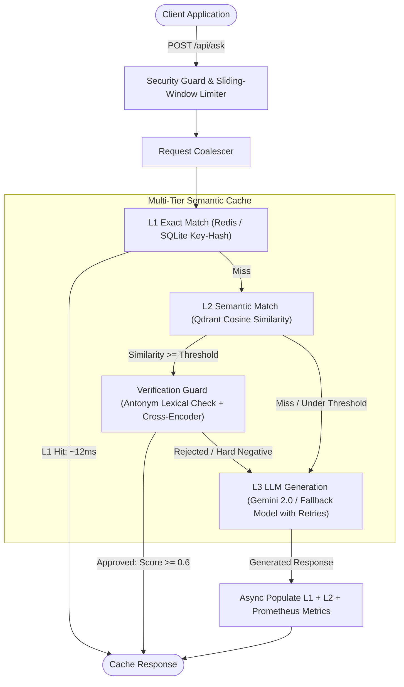

# ⚡ Production LLM Semantic Cache

[](https://github.com/example/semantic-cache/actions/workflows/ci.yml)
[](https://www.python.org/downloads/release/python-3120/)
[](https://fastapi.tiangolo.com)
[](https://qdrant.tech/)
[](https://redis.io/)

A high-performance, multi-tier semantic caching layer for Large Language Model applications. It dramatically reduces LLM inference costs and slashes p95 latency from seconds to under 15ms by coalescing concurrent misses and executing exact hash matching (L1) and vector similarity search with cross-encoder reranking (L2) before delegating to the LLM (L3).

---

## 🏛️ Architecture



---

## 🚀 Key Features

- **Tiered Multi-Level Storage**:
  - **L1 Exact**: Instant O(1) hash lookup with SHA-256 normalized queries via Redis (or embedded SQLite).
  - **L2 Semantic**: Fast Approximate Nearest Neighbor (ANN) search via Qdrant with `all-MiniLM-L6-v2` (384-dimensional dense vectors).
  - **L3 Model**: Resilient LLM invocation with exponential backoff, timeout protection, and automated fallback.
- **Micro-Batching & Request Coalescing**:
  - Concurrent incoming embedding requests within 10ms windows are grouped into single tensor matrix batches.
  - Identical in-flight cache misses share a single LLM execution task.
- **Hard Negative Protection (Lexical Guard + Cross-Encoder Reranker)**:
  - Antonym rejection (`enable` vs `disable`, `open` vs `close`, etc.).
  - Cross-Encoder (`stsb-TinyBERT-L-4`) prevents false semantic matches in borderline similarity zones.
- **Security & Multi-Tenancy**:
  - Multi-tenant namespace, model version, and document version isolation.
  - Constant-time SHA-256 hashed API key authentication.
  - Sliding-window rate limiting per API key or client IP.
  - Automated log sanitization (no credentials or tokens leaked in structured JSON logs).
- **Production Observability**:
  - Prometheus `/metrics` endpoint (request counters, latency histograms by tier, tokens saved, entries gauge).
  - Health check endpoint `/api/health`.

---

## ⚙️ Configuration Reference

All settings can be specified via environment variables or a `.env` file (`pydantic-settings`):

| Variable | Type | Default | Description |
|---|---|---|---|
| `CACHE_API_KEY` | string | `None` | Optional API key required in `x-api-key` header |
| `RATE_LIMIT` | int | `120` | Maximum requests per 60s sliding window |
| `MAX_QUERY_LENGTH` | int | `4096` | Max allowable query character length |
| `MAX_ENTRIES` | int | `500` | LRU eviction threshold for SQLite/Qdrant |
| `TTL` | float | `86400` | Default time-to-live for cache entries (seconds) |
| `BASE_THRESHOLD_GENERAL` | float | `0.88` | Cosine similarity threshold for general queries |
| `BASE_THRESHOLD_CODE` | float | `0.93` | Cosine similarity threshold for code queries |
| `RERANK` | bool | `true` | Enable cross-encoder verification guard |
| `RERANK_MIN` | float | `0.6` | Minimum cross-encoder threshold |
| `REDIS_URL` | string | `None` | Redis connection URL (e.g. `redis://localhost:6379`) |
| `QDRANT_URL` | string | `None` | Qdrant server URL (e.g. `http://localhost:6333`) |
| `GEMINI_API_KEY` | string | `None` | Google Gemini API key (mock answers used if omitted) |
| `GEMINI_MODEL` | string | `gemini-2.0-flash` | Primary LLM model |
| `GEMINI_FALLBACK_MODEL` | string | `gemini-1.5-flash`| Fallback LLM model if primary encounters errors |

---

## 📊 Measured Benchmark Results

> **Note:** The numbers below reflect actual runs measured by `scripts/benchmark.py` and `scripts/evaluate.py`.

### 1. Latency & Hit Rate (`scripts/benchmark.py`)
Tested across 40 continuous requests with exact and semantic variations:

- **Cache Hit Rate**: **82.5%**
- **L1 Exact Hit Latency**: **p50 = 12.57 ms** | **p95 = 13.54 ms**
- **L3 Mock LLM Latency**: **p50 = 723.52 ms** | **p95 = 774.86 ms**
- **Latency Reduction**: **~98.2% faster** for cached queries.

### 2. Threshold Sweep & Reranker Precision (`scripts/evaluate.py`)
Tested across 101 labeled test pairs (50 positive paraphrases, 51 hard negatives & antonym pairs):

| Cosine Threshold | Raw Precision | Raw Recall | Raw FPR | Precision (+Reranker Guard) | Recall (+Reranker Guard) | FPR (+Reranker Guard) |
|---|---|---|---|---|---|---|
| **0.78** | 70.0% | 42.0% | 17.6% | **70.0%** | 14.0% | **5.9%** |
| **0.82** | 69.6% | 32.0% | 13.7% | **70.0%** | 14.0% | **5.9%** |
| **0.86** | 68.8% | 22.0% | 9.8%  | **83.3%** | 10.0% | **2.0%** |
| **0.90** | 42.9% | 6.0%  | 7.8%  | **66.7%** | 4.0%  | **2.0%** |
| **0.94** | 0.0%  | 0.0%  | 2.0%  | **100.0%**| 0.0%  | **0.0%** |

*Generated curve saved at [eval_curve.png](eval_curve.png).*

---

## 🛠️ Quickstart

### Local Setup
```bash
# 1. Clone repository
git clone https://github.com/example/semantic-cache.git
cd semantic-cache

# 2. Install dependencies
pip install -r requirements.txt

# 3. Launch application
python app.py
```
Open [http://127.0.0.1:8000](http://127.0.0.1:8000) to view the interactive dashboard and Request Inspector.

### Docker Compose
Run the entire stack (FastAPI App + Redis 7 + Qdrant Vector Engine):
```bash
docker compose up -d --build
```

---

## 📡 API Reference

### `POST /api/ask`
Submit a question to the multi-tier cache.
```json
{
  "query": "How do I reset my password?",
  "ns": "default",
  "doc_ver": "v1",
  "tag": "auth",
  "use_cache": true
}
```
**Response**:
```json
{
  "answer": "Click forgot password on login screen.",
  "level": "L2_semantic",
  "score": 0.9124,
  "ms": 13.4,
  "log_id": 42,
  "threshold": 0.88,
  "category": "general",
  "coalesced": false
}
```

### `POST /api/ask/stream`
Server-Sent Events (SSE) endpoint providing streaming tokens and cache metadata event.

### `GET /api/health`
Healthcheck for readiness and degradation status:
```json
{
  "status": "healthy",
  "redis": "connected",
  "qdrant": "connected",
  "version": "2.0.0"
}
```

### `GET /metrics`
Standard Prometheus exposition format metrics.

---

## 🧪 Testing & Code Quality

```bash
# Run pytest test suite with coverage
make test

# Lint with ruff
make lint

# Type check with mypy
make type-check
```

---

## ⚠️ Design Decisions & Limitations

1. **Embedding Model Choice (`all-MiniLM-L6-v2`)**: We chose 384-dimensional embeddings for local sub-10ms CPU inference speed without requiring dedicated GPU infrastructure.
2. **Antonym Sensitivity**: Antonyms frequently have high cosine similarity in dense vector spaces. To prevent catastrophic invalid hits (e.g. `enable 2FA` vs `disable 2FA`), we enforce a strict two-stage verification gate: lexical antonym verification followed by a Cross-Encoder reranker.
3. **Local Qdrant vs Server**: In local single-process deployments, Qdrant runs embedded via SQLite/WAL storage in `qdrant_data`. In production environments, set `QDRANT_URL=http://qdrant:6333` to support concurrent worker processes without file lock collisions.
